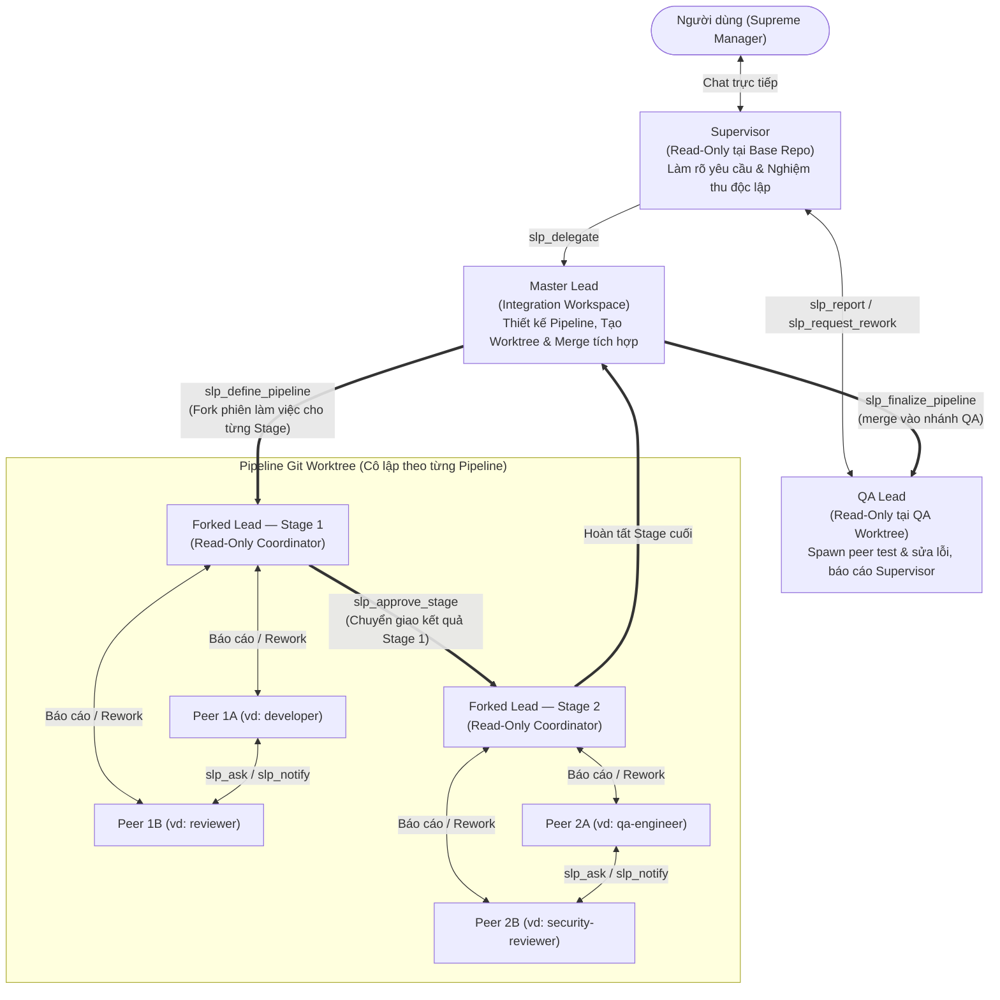
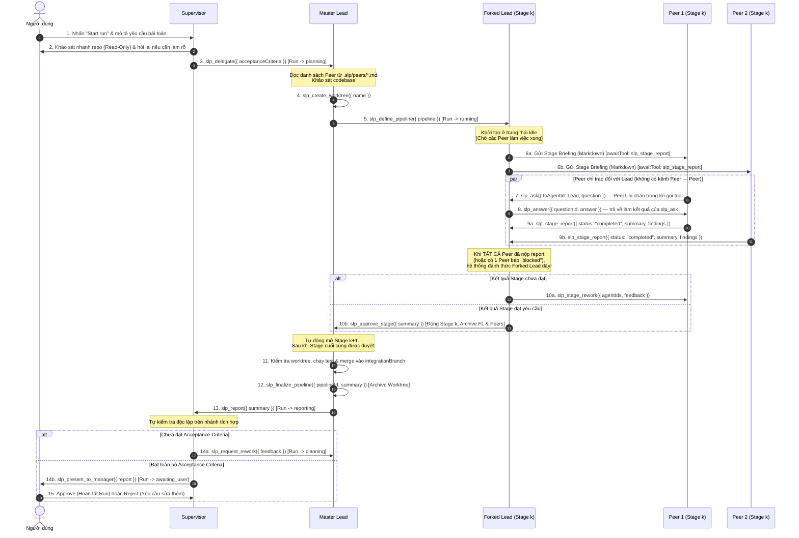

# Paseo SLP Orchestrator (`paseo-slp-orchestrator`)

**SLP Orchestrator** là plugin điều phối đa tác tử (Multi-Agent Orchestration) dành cho **Paseo**, vận hành theo mô hình phân cấp 3 tầng **Supervisor – Lead – Peer (SLP)** kết hợp với **Dynamic Stage Pipeline (`dynamic-stages-v1`)**.

Thay vì ép mọi dự án vào một quy trình cứng nhắc, SLP cho phép bạn trò chuyện trực tiếp với một **Supervisor** duy nhất; **Master Lead** sẽ tự động thiết kế một đường ống (Pipeline) gồm nhiều giai đoạn (Stages) tuần tự trên một Git Worktree cô lập; mỗi Stage được điều phối bởi một **Forked Lead** cùng một hoặc nhiều **Peer** chuyên trách (được định nghĩa linh hoạt trong thư mục `.slp/` của dự án).

---

## Mục lục

1. [Tổng quan kiến trúc & 4 vai trò Runtime](#1-tổng-quan-kiến-trúc--4-vai-trò-runtime)
2. [Nguyên lý hoạt động cốt lõi](#2-nguyên-lý-hoạt-động-cốt-lõi)
3. [Quy trình làm việc chi tiết từ A → Z (Workflow)](#3-quy-trình-làm-việc-chi-tiết-từ-a--z-workflow)
4. [Cơ chế giao tiếp giữa các tầng (`S ↔ L`, `L ↔ P`, `P ↔ P`)](#4-cơ-chế-giao-tiếp-giữa-các-tầng-s--l-l--p-p--p)
5. [Hướng dẫn cấu hình chi tiết & Ý nghĩa từng phần cấu hình](#5-hướng-dẫn-cấu-hình-chi-tiết--ý-nghĩa-từng-phần-cấu-hình)
   - [5.1. Cấu hình trên giao diện Paseo (Start Run & Settings)](#51-cấu-hình-trên-giao-diện-paseo-start-run--settings)
   - [5.2. Cấu hình Role Workflows trong thư mục `.slp/`](#52-cấu-hình-role-workflows-trong-thư-mục-slp)
   - [5.3. Cấu trúc định nghĩa Pipeline (`slp_define_pipeline`)](#53-cấu-trúc-định-nghĩa-pipeline-slp_define_pipeline)
   - [5.4. Lưu trữ dữ liệu SQLite & Biến môi trường (`SLP_HOME`)](#54-lưu-trữ-dữ-liệu-sqlite--biến-môi-trường-slp_home)
6. [Bảng tra cứu công cụ MCP (`slp-bus`)](#6-bảng-tra-cứu-công-cụ-mcp-slp-bus)
7. [Cơ chế tự phục hồi & Hồi sinh Agent (Self-Healing & Revival)](#7-cơ-chế-tự-phục-hồi--hồi-sinh-agent-self-healing--revival)
8. [Hướng dẫn sử dụng & Bộ công cụ dòng lệnh (`tools/bin/`)](#8-hướng-dẫn-sử-dụng--bộ-công-cụ-dòng-lệnh-toolsbin)

---

## 1. Tổng quan kiến trúc & 4 vai trò Runtime

Hệ thống phân tách rõ ràng giữa **Vai trò điều phối hệ thống (Runtime Roles)** và **Vai trò chuyên môn nghiệp vụ (Project Peer Roles)**:



### Bốn vai trò Runtime cố định (`SlpRole`)

| Vai trò Runtime | Số lượng | Quyền hạn File / Git | Trách nhiệm chính |
| :--- | :--- | :--- | :--- |
| **`supervisor`** | 1 / Run | **Read-Only** (Chỉ đọc trên nhánh gốc `baseBranch`) | Đầu mối duy nhất giao tiếp với người dùng. Thu thập yêu cầu, lập bộ tiêu chí nghiệm thu (`Acceptance Criteria`), ủy quyền cho `Master Lead`, tự mình kiểm tra độc lập kết quả cuối cùng trước khi trình bày cho người dùng hoặc yêu cầu làm lại. |
| **`master_lead`** | 1 / Run | **Read / Write** (Trên nhánh tích hợp `integrationBranch` & quản lý Worktree) | Kiến trúc sư trưởng kiêm người sở hữu nhánh tích hợp. Khảo sát codebase, tạo Git worktree bằng `slp_create_worktree`, thiết kế cấu trúc Pipeline nhiều Stage bằng `slp_define_pipeline`, xử lý các trường hợp bế tắc (`escalate`), kiểm tra & merge kết quả từ pipeline worktree vào nhánh tích hợp (`slp_finalize_pipeline`) và báo cáo cho `Supervisor` (`slp_report`). |
| **`forked_lead`** | 1 / Stage | **Read-Only** (Trên worktree của Pipeline) | Điều phối viên của **một Stage cụ thể** (được fork từ ngữ cảnh của `Master Lead` hoặc khởi tạo với đầy đủ trạng thái Pipeline). Theo dõi các Peer trong Stage, đối chiếu bằng chứng thực tế trong worktree với mục tiêu Stage (`stage.goal`), quyết định duyệt Stage (`slp_approve_stage`), yêu cầu Peer sửa lại (`slp_stage_rework`), hoặc báo cáo bế tắc lên `Master Lead` (`slp_escalate`). |
| **`qa_lead`** | 1 / Run | **Read-Only** (Trong QA worktree = nhánh tích hợp `integrationBranch`) | Được spawn cùng lúc với các Lead, nhận cùng yêu cầu và danh sách Lead để chuẩn bị kế hoạch test (unit, automation, manual theo `.slp/standards/TEST_POLICY.md`). Mọi Lead merge nhánh của mình vào nhánh QA và tự giải quyết conflict. Sau khi feature cuối cùng merge xong, QA Lead định nghĩa pipeline QA ngay trong QA worktree, peer fork từ phiên của nó để test và sửa lỗi (QA Lead không tự sửa code), đóng pipeline bằng `slp_finalize_pipeline` rồi là người duy nhất được gọi `slp_report`. Yêu cầu rework của `Supervisor` cũng quay về QA Lead. |
| **`peer`** | $1..N$ / Stage | **Read / Write** (Chia sẻ chung `pipeline.worktree`) | Chuyên gia thực thi công việc trong một Stage theo đúng quy trình trong `.slp/peers/<ROLE>.md` (ví dụ: `developer`, `reviewer`, `qa-engineer`, `security-reviewer`...). Mỗi Peer có một `kind`: `advisor` (chỉ tham gia Stage planning, chỉ đọc), `developer` (người duy nhất được ghi code trong Stage) hoặc `qa` (chấm bảng điểm, chỉ đọc). Peer **chỉ** liên lạc với Lead của mình qua `slp_ask` / `slp_notify` và nộp kết quả qua `slp_stage_report`. Xem mục 4.2. |

---

## 2. Nguyên lý hoạt động cốt lõi

### 2.1. Giao tiếp độc quyền qua MCP Bus nội bộ (`slp-bus`)
- Khi plugin khởi chạy trên Paseo daemon, nó mở một HTTP MCP Server nội bộ trên cổng loopback (`127.0.0.1:<random_port>/mcp`).
- Mỗi Agent khi được tạo ra sẽ được cấp một **Bearer Token định danh riêng** (`AgentRecord.token`).
- Dựa vào Token này, `slp-bus` xác thực chính xác Agent thuộc Run nào, giữ vai trò gì (`supervisor`, `master_lead`, `forked_lead`, hay `peer`) và **chỉ mở đúng những công cụ MCP mà vai trò đó được phép gọi**.
- Đối với các Provider hỗ trợ HTTP MCP trực tiếp (như Claude, Codex, OpenCode), cấu hình `mcpServers` được truyền thẳng vào phiên. Đối với các Provider ACP/Plugin như **Antigravity (`agy`)**, hệ thống tự động sinh cầu nối stdio `~/.slp-orchestrator/slp-mcp-bridge.mjs`, đăng ký vào `~/.gemini/config/mcp_config.json` với cờ `eager: true` và tiêm biến môi trường xác thực qua hook `agent.session_open`.

### 2.2. Hàng đợi tin nhắn bất đồng bộ (`Mailbox`) — Không cắt ngang lượt chạy
- Trong môi trường đa tác tử, nhiều Peer có thể gửi tin nhắn hoặc nộp báo cáo cùng lúc. Nếu bơm trực tiếp một prompt mới vào một Agent đang chạy dở lượt (`status === "running"`), phiên làm việc của Agent đó sẽ bị gián đoạn.
- Do đó, mọi giao tiếp trong SLP đều đi qua bảng hàng đợi **`mailbox` trong SQLite**:
  1. Khi Agent A gọi công cụ gửi tin/báo cáo cho Agent B, bản ghi tin nhắn và thay đổi trạng thái được ghi **nguyên tử (atomic)** vào SQLite.
  2. Bộ chuyển phát `Mailbox.flush()` kiểm tra trạng thái thực tế của Agent B trên Paseo.
  3. Chỉ khi Agent B ở trạng thái nghỉ (`idle`, `closed`, hoặc `error`) và không có yêu cầu cấp quyền nào đang chờ (`pendingPermissions.length === 0`), `Mailbox.flush()` mới gom toàn bộ tin nhắn đang chờ của Agent B (nối bằng `\n\n---\n\n`) và đánh thức Agent B dậy trong một lượt duy nhất.

### 2.3. Theo dõi nghĩa vụ công cụ (`awaitingTool`) & Nhắc nhở tự động (`Sweeper`)
- Mỗi khi một Agent nhận nhiệm vụ mới từ `Mailbox`, hệ thống gắn nhãn công cụ mà Agent đó **bắt buộc phải gọi** để kết thúc nhiệm vụ vào trường `agent.awaitingTool` (ví dụ: `Master Lead` nợ `slp_define_pipeline`, `Peer` nợ `slp_stage_report`, `Forked Lead` nợ `slp_approve_stage`, `Supervisor` nợ `slp_present_to_manager`).
- Các công cụ chỉ đọc (`slp_get_run`, `slp_list_pipelines`, `slp_get_pipeline`) trả về dữ liệu tức thì và **không** xóa nghĩa vụ `awaitingTool`.
- Nếu một Agent kết thúc lượt trả lời mà quên gọi công cụ workflow đang nợ, hook `after("agent.turn_complete")` và bộ quét định kỳ **Sweeper** sẽ tự động gửi thông điệp nhắc nhở (`nudge`, tối đa `NUDGE_LIMIT = 2` lần) để yêu cầu Agent hoàn tất công cụ đó.
- Ngay khi Agent gọi thành công công cụ workflow đang nợ, bộ điều phối sẽ xóa `awaitingTool = null` và **dọn sạch mọi tin nhắn nhắc nhở/retry cũ cùng loại còn sót trong `mailbox`** để không bao giờ nhắc lại một nghĩa vụ đã hoàn thành.

### 2.4. Kiểm soát biên giới ghi file (Write Boundaries)
- Hook `before("agent.permission_Requested")` đóng vai trò tường lửa cấp ứng dụng:
  - Tự động **chấp thuận (allow)** mọi lời gọi tới MCP server `slp-bus`.
  - Tự động **từ chối (deny)** mọi thao tác sửa/ghi file từ `Supervisor` và `Forked Lead` (đảm bảo tính khách quan của người giám sát và điều phối viên Stage).
  - Chỉ cho phép các `Peer` có `kind: developer` ghi file bên trong phạm vi `pipeline.worktree` được giao; Peer `advisor` và `qa` luôn chỉ đọc (kể cả lệnh shell có tính ghi như `git commit`, `rm`, `mkdir`).

---

## 3. Quy trình làm việc chi tiết từ A → Z (Workflow)

Sơ đồ dưới đây mô tả trọn vẹn vòng đời của một phiên chạy (**Run**) từ lúc người dùng bấm **Start run** cho đến khi nghiệm thu hoàn tất:



### Chi tiết từng bước trong quy trình:

1. **Khởi tạo Run (`initializing`)**:
   - Khi bạn chọn thư mục dự án và nhấn **Start run**, daemon kiểm tra nhánh Git gốc (`baseBranch`), tạo một nhánh tích hợp riêng cho Run (`integrationBranch`, dạng `slp/run-<id>`), chụp bản sao (snapshot) toàn bộ cấu hình `.slp/` vào SQLite, đồng thời khởi tạo 2 Agent đầu tiên: `Supervisor` và `Master Lead`.
   - Giao diện Paseo tự động chuyển sang khung chat của `Supervisor` và `Supervisor` gửi lời chào mở đầu.

2. **Thảo luận & Ủy quyền (`initializing` → `delegating` → `planning`)**:
   - Bạn mô tả tính năng hoặc lỗi cần xử lý cho `Supervisor`.
   - `Supervisor` (chỉ đọc) có thể xem các file trong repo hoặc hỏi lại bạn nếu yêu cầu còn mơ hồ.
   - Khi yêu cầu đã rõ ràng, `Supervisor` gọi **`slp_delegate({ acceptanceCriteria })`** để chuyển giao bài toán kèm bộ tiêu chí nghiệm thu chi tiết cho `Master Lead`. Trạng thái Run chuyển sang `planning` và `Master Lead` được gán nghĩa vụ `awaitingTool = "slp_define_pipeline"`.

3. **Lập kế hoạch & Tạo Pipeline (`planning` → `running`)**:
   - `Master Lead` đọc tiêu chí nghiệm thu, khảo sát kiến trúc dự án và đối chiếu danh sách các Peer Role hiện có trong `.slp/peers/*.md` (đã được tiêm sẵn phần tóm tắt YAML front-matter vào `systemPrompt` của `Master Lead`).
   - `Master Lead` gọi **`slp_create_worktree({ name })`** để tạo một Git worktree riêng biệt (nằm ngoài thư mục gốc của bạn, dưới sự quản lý của Paseo) giúp quá trình code/test của các Peer hoàn toàn cô lập.
   - Tiếp theo, `Master Lead` gọi **`slp_define_pipeline({ pipeline })`** truyền vào cấu trúc JSON gồm danh sách các `stages` tuần tự, mục tiêu (`goal`) của từng Stage, và danh sách `peers` (`role` + `task`) trong mỗi Stage.

4. **Kích hoạt Stage & Thực thi đồng thời (`Stage Running`)**:
   - Hệ thống mở Stage đầu tiên (`currentStageIndex = 0`):
     - Tạo 1 **`Forked Lead`** để làm điều phối viên riêng cho Stage đó. Để tiết kiệm lượt model và tránh đánh thức thừa, **`Forked Lead` được giữ ở trạng thái `idle` (ngủ chờ)** lúc mới mở Stage.
     - Tạo toàn bộ các **`Peer`** được giao trong Stage đó (mỗi Peer mang `systemPrompt` được nạp từ file `.slp/peers/<ROLE>.md` tương ứng).
   - Sau khi cả đội hình (cohort) của Stage đã được tạo xong, hệ thống mới đẩy bản giao việc (**Stage Briefing** định dạng Markdown gọn gàng) vào `mailbox` của từng Peer và đánh thức các Peer chạy song song:
     - Nếu Stage chỉ có **1 Peer**: Bản giao việc hướng dẫn Peer tập trung thực hiện nhiệm vụ và nộp `slp_stage_report` (không hiển thị danh sách Peer thừa).
     - Nếu Stage có **từ 2 Peer trở lên**: Bản giao việc hiển thị thêm mục **`### Stage Peer Roster`** (gồm `role`, `agentId`, và `task` của các Peer đồng cấp cùng ID của `Forked Lead`) để các Peer có thể chủ động trao đổi.

5. **Báo cáo Stage & Cơ chế đánh thức `Forked Lead` thông minh**:
   - Khi mỗi Peer hoàn thành phần việc của mình, Peer gọi **`slp_stage_report({ status, summary, findings })`**.
   - **Cơ chế gom báo cáo (Batching)**:
     - Nếu trong Stage vẫn còn Peer khác đang làm việc và báo cáo vừa nộp có `status === "completed"`, hệ thống lưu báo cáo vào SQLite và **chưa đánh thức `Forked Lead` vội** (tránh việc `Forked Lead` bị gọi dậy lắt nhắt nhiều lần khi chưa đủ bằng chứng).
     - Ngay khi **Peer cuối cùng** trong Stage nộp báo cáo (hoặc ngay lập tức khi có bất kỳ Peer nào báo `status === "blocked"`), hệ thống sẽ đánh thức `Forked Lead` dậy một lần duy nhất kèm bản tổng hợp toàn bộ báo cáo của mọi Peer và gán nghĩa vụ `awaitTool = "slp_approve_stage"`.

6. **Quyết định của `Forked Lead` tại cuối mỗi Stage**:
   - **Trường hợp 1 — Duyệt Stage (`slp_approve_stage({ summary })`)**:
     - `Forked Lead` kiểm tra code/test thực tế trong worktree cùng số liệu kỹ thuật (đầu vào, logic, đầu ra/kết quả đạt được) của các Peer, đồng thời rà soát chống dư thừa/rác hệ thống so với `goal`. Nếu đạt mục tiêu Stage, `Forked Lead` gọi `slp_approve_stage`.
     - **Giữ các Peer sống xuyên suốt Pipeline (Cross-Stage Peer Persistence)**:
       - Nếu đây là **Stage trung gian** (chưa phải Stage cuối cùng của Pipeline), hệ thống lưu `stage.result`, xóa nghĩa vụ của Stage vừa xong nhưng **vẫn giữ sống các Peer của Stage này** (ở chế độ chỉ đọc worktree và sẵn sàng trả lời tin nhắn) cho đến khi kết thúc toàn bộ Pipeline.
       - Khi mở Stage kế tiếp (`currentStageIndex + 1`), ngoài mục **`### Previous Stage Results`**, bản Stage Briefing còn cung cấp mục **`### Prior Stage Peers (Available for Cross-Stage Questions via slp_ask)`** chứa `agentId`, `role`, `task` và tóm tắt báo cáo của từng Peer ở các Stage trước. Nhờ đó, Peer ở Stage sau (như `reviewer`, `qa-engineer`) có thể hỏi trực tiếp (`slp_ask`) các Peer ở Stage trước (như `developer`) về bất kỳ giả định hay chi tiết kỹ thuật nào còn thắc mắc!
       - Chỉ khi **Stage cuối cùng của Pipeline** hoàn thành (và khi `Master Lead` gọi `slp_finalize_pipeline`), hệ thống mới đóng (archive) toàn bộ các Peer và `Forked Lead` của Pipeline đó.
   - **Trường hợp 2 — Yêu cầu làm lại trong Stage (`slp_stage_rework({ agentIds, feedback })`)**:
     - Nếu phát hiện lỗi, thiếu số liệu đầu vào/đầu ra, hoặc sinh dữ liệu/code rác không cần thiết, `Forked Lead` gọi `slp_stage_rework` gửi phản hồi chi tiết cho một số (hoặc tất cả) Peer trong Stage để sửa và nộp lại `slp_stage_report` mới.
   - **Trường hợp 3 — Báo cáo bế tắc lên Master Lead (`slp_escalate({ reason })`)**:
     - Nếu gặp xung đột kiến trúc vượt thẩm quyền của Stage, `Forked Lead` gọi `slp_escalate`. Hệ thống tạm dừng Pipeline (`status = "paused"`) và đánh thức `Master Lead` dậy xử lý bằng `slp_resume_pipeline`.

7. **Hoàn tất Pipeline, Tích hợp & Nghiệm thu (`reporting` → `awaiting_user` → `completed`)**:
   - Khi Stage cuối cùng của Pipeline được `Forked Lead` duyệt, toàn bộ Peer và `Forked Lead` trong Pipeline được đóng lại, Pipeline chuyển sang trạng thái `completed` và đánh thức `Master Lead` với nghĩa vụ `slp_finalize_pipeline`.
   - `Master Lead` kiểm tra toàn bộ thay đổi và số liệu kỹ thuật trên worktree của Pipeline (đảm bảo không có dữ liệu thừa hay rác hệ thống), merge nhánh worktree vào nhánh tích hợp (`integrationBranch`), sau đó gọi **`slp_finalize_pipeline({ pipelineId, summary })`**. Hệ thống xác thực commit đã được merge vào `integrationBranch`, tự động dọn dẹp (archive) worktree của Pipeline và chuyển nghĩa vụ của `Master Lead` sang `slp_report`.
   - Ngay trong cùng lượt đó (hoặc lượt kế tiếp), `Master Lead` gọi **`slp_report({ summary })`** để gửi báo cáo tổng kết cho `Supervisor`.
   - `Supervisor` được đánh thức với nghĩa vụ `slp_present_to_manager`. `Supervisor` tự mình kiểm tra độc lập kết quả trên nhánh tích hợp:
     - Nếu đạt mọi tiêu chí: Gọi **`slp_present_to_manager({ report })`** để trình bày báo cáo nghiệm thu cho bạn (người dùng) kèm nút **Approve / Request rework** trên giao diện.
     - Nếu chưa đạt: Gọi **`slp_request_rework({ feedback })`** để trả lại cho `Master Lead` lập Pipeline sửa lỗi.

---

## 4. Cơ chế giao tiếp giữa các tầng (`S ↔ L`, `L ↔ P`, `P ↔ P`) & Quy chuẩn Kỹ thuật

| Luồng giao tiếp | Chiều gửi | Công cụ MCP sử dụng | Cơ chế hoạt động & Đảm bảo an toàn |
| :--- | :--- | :--- | :--- |
| **User ↔ Supervisor** | 2 chiều | Chat trực tiếp trên Paseo UI + Nút Approve/Reject Gate | Chỉ `Supervisor` mới nói chuyện với người dùng. Khi Run ở trạng thái `awaiting_user`, bạn có thể bấm Approve để đóng Run hoặc nhập phản hồi Rework. |
| **Supervisor → Master Lead** | Ủy quyền / Yêu cầu làm lại | `slp_delegate`<br/>`slp_request_rework` | Ghi `criteria` vào SQLite, chuyển Run sang `planning`, đẩy tin nhắn vào `mailbox` của `Master Lead` kèm nghĩa vụ `awaitTool = "slp_define_pipeline"`. |
| **QA Lead → Supervisor** | Báo cáo hoàn thành | `slp_report` | Chỉ được chấp nhận sau khi một pipeline QA đã đóng sau lần merge feature cuối cùng. Ghi `finalReport` vào SQLite, chuyển Run sang `reporting`, đẩy báo cáo vào `mailbox` của `Supervisor` kèm nghĩa vụ `awaitTool = "slp_present_to_manager"`. |
| **Master Lead ↔ Forked Lead** | Khởi tạo Stage / Escalate / Resume | `slp_define_pipeline`<br/>`slp_escalate`<br/>`slp_resume_pipeline` | Khi Stage bị `escalate` (hoặc dừng ở Gate của chế độ `STEP_BY_STEP_DEBUG` / `SEMI_AUTO`), Pipeline chuyển sang `paused` và đánh thức `Master Lead` với nghĩa vụ `slp_resume_pipeline`. |
| **Forked Lead ↔ Peers** | Giao việc / Báo cáo / Rework | `slp_stage_report`<br/>`slp_stage_rework`<br/>`slp_approve_stage` | Các Peer nộp bằng chứng qua `slp_stage_report`. Khi tất cả Peer hoàn tất, `Forked Lead` mới được đánh thức để duyệt (`slp_approve_stage`) hoặc yêu cầu làm lại (`slp_stage_rework`). |
| **Peer → Lead** | Hỏi đáp, thông báo | `slp_ask` / `slp_answer` / `slp_notify` | Peer chỉ được liên lạc với Lead của Stage; bus từ chối mọi tin nhắn Peer ↔ Peer. Lead có thể hỏi Peer trong pipeline của mình. `slp_ask` là **câu hỏi chặn** (trả về câu trả lời ngay trong lời gọi tool); `slp_notify` là **thông báo một chiều**. |

### 4.1. Cơ chế câu hỏi chặn (`slp_ask`) và thông báo (`slp_notify`)
Bus chia tin nhắn giữa các agent thành hai loại có hành vi khác hẳn nhau:

| Loại | Tool | Hành vi |
|---|---|---|
| **Question** | `slp_ask` → `slp_answer` | Người hỏi **bị chặn trong lời gọi tool** đến khi có câu trả lời; câu trả lời trở về làm kết quả của chính lời gọi đó. Mỗi cặp hỏi–đáp chỉ thêm một mục vào context của người hỏi, không tạo thêm lượt và không bị trộn với mail khác. |
| **Notify** | `slp_notify` | Thông báo một chiều qua mailbox, không chờ, không tạo nghĩa vụ. |

Khi Peer A gọi `slp_ask({ toAgentId: PeerB, question })`:
1. Câu hỏi được ghi vào bảng SQLite `questions` (trạng thái `pending`) rồi gửi cho B. Nếu B đang bị chặn trong lời gọi `slp_ask`/`slp_await_answer` của chính nó thì B được **đánh thức ngay** và nhận câu hỏi ngay trong kết quả lời gọi đó (hai bên hỏi nhau cùng lúc không bị deadlock). Ngược lại câu hỏi đến B dưới dạng prompt qua mailbox khi B rảnh.
2. A chờ tối đa **40 giây mỗi lời gọi** (nhỏ hơn timeout 60 giây mặc định của MCP trong Codex). Nếu chưa có câu trả lời, `slp_ask` trả về "chưa có câu trả lời" kèm `questionId`; A làm việc độc lập rồi gọi `slp_await_answer({ questionId })` để chờ tiếp. Nghĩa vụ `slp_stage_report` của A **không bị đụng tới** vì A chỉ đang ở trong một lời gọi tool.
3. B trả lời bằng `slp_answer({ questionId, answer })`. A được đánh thức tức thì (không polling); nếu A không còn chờ thì câu trả lời đến A dưới dạng mail.
4. Quá **10 phút** không có câu trả lời, hoặc B đã bị archive, câu hỏi chuyển sang `expired`; A được báo phải tự đưa ra giả định, ghi rõ giả định đó và tiếp tục. Nếu B trả lời muộn, câu trả lời vẫn được lưu (`answered_late`) và chuyển cho A.
5. Nếu B đã nhận câu hỏi mà vẫn im lặng khi đã rảnh, bộ quét nhắc B tối đa 2 lần (cách nhau 60 giây).

Sổ `questions` là nguồn dữ liệu chính; việc đánh thức chỉ để giảm độ trễ. Bộ quét `Sweeper` đối soát sổ với mailbox mỗi 3 giây nên không câu hỏi hay câu trả lời nào bị mất khi plugin reload hay kết nối bị ngắt.

**Kiểm tra hiệu quả giao tiếp**: mọi câu hỏi/trả lời được lưu vĩnh viễn (kèm thời điểm hỏi, giao, trả lời, số lần nhắc, lý do hết hạn). Dùng RPC `slp.questions.list` để xem danh sách và các chỉ số (tỉ lệ được trả lời, thời gian trả lời trung vị/p90, độ trễ giao, thống kê theo cặp vai trò):

```bash
tools/bin/slp-rpc slp.questions.list '{"runId":"<id>","limit":100}'
```

### 4.2. Brief khóa, một developer và bảng điểm QA (chống over-engineering)

Các Peer và Lead từng làm quá phạm vi được giao. Thiết kế hiện tại dựa trên kinh nghiệm công bố của Anthropic (multi-agent research, harness planner/generator/evaluator) và Cognition (chỉ một luồng ghi code). Engine áp các quy tắc sau:

1. **Hình dạng pipeline feature được kiểm tra khi `slp_define_pipeline`:** `[planning]? -> implement`.
   - `planning` (tùy chọn, luôn là Stage đầu): chỉ Peer `kind: advisor` (ví dụ `architect`, `reviewer`, `security-reviewer`). Họ không viết code, chỉ thảo luận kỹ thuật/thiết kế với Lead và báo cáo đề xuất.
   - `implement`: đúng **một** Peer `kind: developer`, không ai khác.
   - Pipeline feature không tự chấm điểm: Stage `verify` chỉ có trong pipeline của QA Lead.
2. **Brief khóa:** `{ approach, criteria: [{ id, requirement, verification }], inScope, outOfScope }`. Lead đưa brief khi duyệt Stage planning (`slp_approve_stage({ summary, brief })`), hoặc truyền `pipeline.brief` ngay khi định nghĩa nếu không có planning. Sau đó brief bị khóa; developer phải làm đúng brief, muốn khác thì `slp_escalate`. Advisor bị archive khi planning đóng.
3. **Bảng điểm QA:** Trong pipeline QA, Stage `verify` gồm Peer `kind: qa` (chấm điểm, chỉ đọc) và tối đa một developer sửa lỗi. QA nộp `slp_stage_report` kèm `scorecard: [{ criterionId, status: pass|fail|blocked, reason, evidence }]` và `observations` (những gì ngoài tiêu chí, không chấm). QA Lead đọc bảng điểm và **tự quyết định**: duyệt hoặc gửi `slp_stage_rework` cho developer; sau khi developer báo sửa xong, engine tự động yêu cầu QA chấm lại rồi mới đánh thức QA Lead. Developer trong Stage verify không nhận việc cho tới khi có yêu cầu sửa.
4. **Giới hạn rework (mặc định 3 vòng/Stage, cấu hình được):** hết số vòng, `slp_stage_rework` bị từ chối; Lead phải duyệt hoặc `slp_escalate`. Khi đó pipeline dừng với `awaitingHumanDecision`, Supervisor nhận bảng điểm mới nhất, trình bày cho bạn và chuyển quyết định về Lead bằng `slp_relay_decision({ pipelineId, decision })` (bộ đếm vòng được đặt lại). Lead không thể tự `slp_resume_pipeline` trong lúc chờ.
5. **Prompt mặc định:** bỏ các cụm `MANDATORY`/`MUST`, bỏ yêu cầu "trình bày phương án bị loại" và "liệt kê mọi edge case"; thay bằng quy tắc "chỉ làm những gì acceptance criteria và brief yêu cầu" và báo cáo bằng dữ kiện (file đã sửa, lệnh đã chạy, kết quả).

> `.slp/` của dự án đã có từ trước **không tự cập nhật**. Peer cũ không có `kind:` sẽ được suy ra từ tên role (review/architect/design/research → advisor, qa/test → qa, còn lại → developer); nên khai báo `kind:` rõ ràng.

---

## 5. Hướng dẫn cấu hình chi tiết & Ý nghĩa từng phần cấu hình

Hệ thống cấu hình của SLP được thiết kế thành **2 lớp**:
1. **Cấu hình cấp Host / Phiên chạy** (trên giao diện **Start run** và **Settings → SLP Orchestrator**).
2. **Cấu hình cấp Dự án** (trong thư mục **`.slp/`** nằm tại thư mục gốc của từng Git repository).

---

### 5.1. Cấu hình trên giao diện Paseo (Start Run & Settings)

Bạn có thể mở cấu hình tại thanh bên **SLP Orchestrator** (màn hình **Start run**) hoặc vào **Settings → SLP Orchestrator**. Các lựa chọn về `Mode` và `Roles` được lưu tự động ở cấp Host (dùng chung cho mọi client kết nối tới Paseo daemon đó).

| Trường cấu hình | Phạm vi lưu | Ý nghĩa & Công dụng chi tiết |
| :--- | :--- | :--- |
| **Repository folder** | Theo từng Run | Đường dẫn tuyệt đối tới Git repository của dự án. Bạn chọn từ danh sách các project Git đã mở trong Paseo. Ngay khi chọn, SLP sẽ tự động kiểm tra và khởi tạo thư mục `.slp/` nếu chưa có. |
| **Reload role workflows** | Thao tác tức thì | Đọc lại toàn bộ các file `.slp/*.md` và `.slp/peers/*.md` trong repository đã chọn để kiểm tra cú pháp YAML front-matter và cập nhật danh sách các Peer role trước khi bấm Start run. |
| **Name** | Theo từng Run | Tên gợi nhớ **bắt buộc** cho phiên chạy (ví dụ: `"Refactor hệ thống thanh toán"`). Hệ thống tự động thêm số thứ tự `#<sequence>` vào cuối tên để phân biệt các Run trùng tên (ví dụ: `"Refactor hệ thống thanh toán #3"`). |
| **Base branch (optional)** | Theo từng Run | Nhánh Git gốc dùng làm điểm xuất phát và đối chiếu nghiệm thu (ví dụ: `main`, `develop`). Nếu để trống, hệ thống tự động phát hiện nhánh hiện tại của repository. Từ nhánh này, SLP sẽ tạo nhánh tích hợp `slp/run-<runId>`. |
| **Mode** | Lưu mặc định toàn Host | Chế độ kiểm soát mức độ tự động hóa của Pipeline (xem bảng chi tiết 3 chế độ bên dưới). Mặc định là **`FULL_AUTO`**. |
| **Supervisor / Lead / Peer — Model** | Lưu mặc định toàn Host | Chọn `provider/model` (ví dụ: `claude/claude-sonnet-4-5`, `antigravity/gemini-2.5-pro`, `codex/o3`...) cho từng tầng:<ul><li>**Supervisor**: Nên chọn model có khả năng đọc hiểu yêu cầu và kiểm tra chéo tốt.</li><li>**Lead**: Áp dụng cho cả `Master Lead` và các `Forked Lead`. *(Mẹo: Nếu chọn provider là `claude`, các `Forked Lead` sẽ tận dụng được tính năng native session fork của Claude; các provider khác vẫn hoạt động bình thường nhờ cơ chế dựng ngữ cảnh từ SQLite)*.</li><li>**Peer**: Model mặc định cho tất cả các Peer trong các Stage (trừ khi file `.slp/peers/<ROLE>.md` ghi đè bằng trường `model:` riêng).</li></ul> |
| **Supervisor / Lead / Peer — Thinking** | Lưu mặc định toàn Host | Mức độ suy luận sâu (`thinkingOptionId`, ví dụ: `low`, `medium`, `high`, `xhigh` tùy theo model hỗ trợ). Giúp kiểm soát cân bằng giữa tốc độ/chi phí và độ sâu tư duy cho từng vai trò. |
| **Supervisor / Lead / Peer — Permission** | Lưu mặc định toàn Host | Chế độ cấp quyền thực thi công cụ (`permissionModeId`) của từng Provider. Mặc định khi chưa chỉnh, SLP tự động chọn chế độ **Unattended / Full Access** của Provider đó để các Agent có thể chạy tự động không bị chặn hỏi quyền thủ công, kết hợp với hook kiểm soát biên giới đọc/ghi của SLP. |
| **Fork peers from the Lead session** | Lưu mặc định toàn Host (chụp vào Run lúc bắt đầu) | Mặc định **Off**: Peer khởi tạo sạch và chỉ làm việc theo briefing (brief khóa). Bật **On** để Peer fork phiên của Lead (khi provider hỗ trợ) nhằm so sánh hiệu quả. Run tạo trước khi có cài đặt này vẫn fork như cũ. |
| **Max rework rounds per stage before asking you** | Lưu mặc định toàn Host (chụp vào Run lúc bắt đầu) | Mặc định **3**. Số lần `slp_stage_rework` tối đa mỗi Stage; hết số vòng thì Lead phải duyệt hoặc escalate để bạn quyết định qua Supervisor. |

#### Giải thích chi tiết 3 chế độ vận hành (`Mode`):

| Chế độ (`Mode`) | Cổng duyệt sau mỗi Stage (`after_stage`) | Cổng duyệt trước khi tích hợp (`before_integration`) | Khi nào nên sử dụng? |
| :--- | :---: | :---: | :--- |
| **`FULL_AUTO`** *(Mặc định)* | Không dừng (Tự động chuyển Stage ngay khi `Forked Lead` gọi `slp_approve_stage`) | Không dừng (Tự động đánh thức `Master Lead` để `finalize` & báo cáo `Supervisor`) | Khi bạn muốn hệ thống tự động chạy xuyên suốt từ lúc `Supervisor` ủy quyền cho tới khi `Supervisor` trình bày kết quả cuối cùng. |
| **`SEMI_AUTO`** | Không dừng giữa các Stage | **Dừng lại chờ duyệt** sau khi tất cả các Stage đã xong nhưng **trước khi** `Master Lead` merge/finalize vào nhánh tích hợp | Khi bạn muốn các Peer tự động code/review/test qua các Stage, nhưng muốn kiểm tra lần cuối trước khi `Master Lead` chốt tích hợp. |
| **`STEP_BY_STEP_DEBUG`** | **Dừng lại sau mỗi Stage** (Ngay sau khi `Forked Lead` duyệt một Stage, Pipeline chuyển sang `paused` mở cổng `after_stage`) | Có kiểm soát từng bước | Khi bạn đang thiết kế quy trình `.slp/` mới, muốn kiểm tra kỹ kết quả của từng Stage một trước khi cho phép chạy sang Stage kế tiếp. |

---

### 5.2. Cấu hình Role Workflows trong thư mục `.slp/`

Khi bạn chọn một dự án trong SLP, nếu dự án chưa có thư mục `.slp/`, hệ thống sẽ tự động khởi tạo bộ khung mặc định:

```text
.slp/
├── SUPERVISOR.md              # Cấu hình & quy trình làm việc của Supervisor
├── LEAD.md                    # Cấu hình & quy trình làm việc của Master Lead / Forked Lead
├── QA_LEAD.md                 # Cấu hình & quy trình làm việc của QA Lead (tự tạo lại nếu thiếu)
└── peers/                     # Thư mục chứa định nghĩa tất cả các Peer chuyên môn của dự án
    ├── ARCHITECT.md           # role: architect          (kind: advisor)
    ├── DEVELOPER.md           # role: developer          (kind: developer)
    ├── QA_ENGINEER.md         # role: qa-engineer        (kind: qa)
    ├── REVIEWER.md            # role: reviewer           (kind: advisor)
    └── SECURITY_REVIEWER.md   # role: security-reviewer  (kind: advisor)
```

> **Lưu ý quan trọng**:
> - `.slp/` chỉ chứa các file cấu hình quy trình (`.md`) do bạn quản lý và có thể commit vào Git để chia sẻ cho cả nhóm.
> - SLP **không bao giờ** ghi file log, file spec tạm hay báo cáo runtime vào thư mục `.slp/` hoặc vào cây thư mục dự án của bạn (mọi dữ liệu runtime đều nằm trong `~/.slp-orchestrator/orchestrator.sqlite3`).
> - Khi một Run bắt đầu, toàn bộ nội dung `.slp/` được **chụp snapshot vào SQLite** của Run đó. Nhờ vậy, nếu bạn sửa file `.slp/` trong lúc một Run đang chạy, Run đang chạy vẫn giữ nguyên quy trình nhất quán từ đầu, còn Run mới tiếp theo sẽ nhận quy trình mới.

#### Cấu trúc của một file `.slp/peers/<TEN_FILE>.md`:

Mỗi file Markdown trong `.slp/` bao gồm **2 phần**: phần đầu là **YAML Front-matter** (nằm giữa hai dòng `---`) và phần thân là **Markdown Workflow** (`# Workflow`):

```markdown
---
role: qa-engineer
name: QA Engineer
description: Kiểm thử hành vi thực tế, kiểm tra các trường hợp biên (edge cases) và độ phủ hồi quy.
model:
thinking:
kind: qa
---

# Workflow

Focus on exercising the delivered behavior, regression coverage, boundary conditions and reproducible verification evidence.

1. Read the current stage assignment and goal.
2. Inspect the shared pipeline worktree and run relevant automated tests.
3. Challenge peers directly using `slp_ask` if you find defects or untested assumptions.
4. Submit concrete verification evidence using `slp_stage_report`.
```

#### Ý nghĩa và công dụng của từng trường trong YAML Front-matter:

| Trường YAML | Bắt buộc? | Công dụng & Nguyên lý hoạt động |
| :--- | :---: | :--- |
| **`role`** | **Bắt buộc** | Mã định danh duy nhất của vai trò (ví dụ: `developer`, `qa-engineer`, `database-architect`). Hệ thống tự động chuẩn hóa chữ thường và đổi khoảng trắng/dấu gạch dưới `_` thành dấu gạch ngang `-` (ví dụ `qa_engineer` và `qa-engineer` đều khớp nhau). `Master Lead` sẽ dùng mã `role` này khi gọi `slp_define_pipeline`. |
| **`name`** | Tùy chọn *(Khuyên dùng)* | Tên hiển thị thân thiện của vai trò trên giao diện Paseo UI, thẻ Stage, và trong các bản Stage Briefing / Báo cáo (nếu bỏ trống sẽ lấy giá trị của `role`). |
| **`description`** | **Bắt buộc** | Mô tả ngắn gọn chuyên môn và nhiệm vụ của vai trò này. **Cực kỳ quan trọng**: Toàn bộ `role`, `name`, `description` và YAML front-matter của các file trong `.slp/peers/*.md` được tiêm trực tiếp vào `systemPrompt` của **`Master Lead`**. Nhờ đọc `description` này, `Master Lead` mới biết dự án có những chuyên gia nào để tự động chọn và ghép vào các Stage phù hợp! |
| **`model`** | Tùy chọn | Ghi đè (override) model riêng cho vai trò này:<ul><li>Nếu **để trống / `null`**: Tự động **kế thừa** model đã chọn ở mục `Supervisor` / `Lead` / `Peer` trên form Start run.</li><li>Nếu ghi **`provider/model-id`** đầy đủ (ví dụ: `claude/claude-opus-4-6`): Sử dụng đúng provider và model đó cho vai trò này (và tự động ánh xạ lại chế độ quyền Full Access tương ứng của provider mới).</li><li>Nếu chỉ ghi **`model-id` ngắn**: Giữ nguyên provider đã chọn trên form nhưng đổi sang model đó.</li></ul> |
| **`thinking`** | Tùy chọn | Ghi đè mức độ suy luận (`thinkingOptionId`) riêng cho vai trò này (ví dụ: `high`). Nếu để trống, tự động kế thừa lựa chọn `Thinking` trên form Start run. |
| **`kind`** | Khuyên dùng | `advisor`, `developer` hoặc `qa`. Quyết định Stage mà Peer được tham gia và quyền ghi (chỉ `developer` được ghi). Bỏ trống thì engine đoán theo tên role. |
| **Các trường YAML tùy ý khác** | Tùy chọn | Bạn có thể thêm các trường metadata nghiệp vụ tùy ý (như `features`, `tech_stack`, `owned_paths`...) vào YAML front-matter của `.slp/peers/*.md`. Vì nguyên khối YAML front-matter được đưa vào `systemPrompt` của `Master Lead`, `Master Lead` sẽ đọc được các thông tin này để phân công đúng chuyên gia cho từng module! |
| **Phần thân Markdown (`# Workflow`)** | **Bắt buộc** | Quy trình làm việc chi tiết dành riêng cho Agent mang vai trò đó. Phần thân này **không** làm nặng prompt của `Master Lead`, mà chỉ được nạp vào `systemPrompt` của đúng `Peer` (hoặc `Supervisor` / `Lead`) khi Agent đó được tạo ra. |

#### Cách thêm một Peer Role mới cho dự án của bạn:
1. Tạo một file Markdown mới trong `.slp/peers/` (hoặc bất kỳ thư mục con nào bên trong `.slp/peers/`), ví dụ `.slp/peers/PERFORMANCE_ENGINEER.md`.
2. Khai báo phần đầu YAML front-matter với `role: performance-engineer`, `name: Performance Engineer`, `description: ...` và viết hướng dẫn kiểm tra hiệu năng ở phần `# Workflow`.
3. Trên giao diện SLP, nhấn nút **Reload role workflows** — bạn sẽ thấy số lượng peer roles tăng lên ngay lập tức và `Master Lead` ở lượt chạy tiếp theo sẽ tự động biết cách huy động `performance-engineer` khi bài toán có yêu cầu tối ưu hiệu năng.

---

### 5.3. Cấu trúc định nghĩa Pipeline (`slp_define_pipeline`)

Khi `Master Lead` thiết kế Pipeline, nó gửi một cấu trúc JSON vào công cụ `slp_define_pipeline`. Hiểu rõ cấu trúc này giúp bạn dễ dàng theo dõi trên **SLP Monitor** hoặc tùy chỉnh hướng dẫn trong `.slp/LEAD.md`:

```json
{
  "pipeline": {
    "name": "auth-token-rotation",
    "version": "1.0",
    "description": "Triển khai cơ chế xoay vòng refresh token.",
    "stages": [
      {
        "name": "planning",
        "kind": "planning",
        "goal": "Chọn cách xoay vòng token và khóa brief.",
        "peers": [
          { "role": "architect", "task": "Đề xuất vị trí và cấu trúc đơn giản nhất cho luồng xoay vòng token." },
          { "role": "security-reviewer", "task": "Chỉ ra rủi ro replay attack mà brief cần bao phủ." }
        ]
      },
      {
        "name": "implement",
        "kind": "implement",
        "goal": "Xây dựng đúng brief đã khóa.",
        "peers": [
          { "role": "developer", "task": "Cập nhật dịch vụ xác thực và thêm unit test cho luồng xoay vòng token." }
        ]
      }
    ]
  }
}
```

Lead đóng Stage planning bằng:

```json
{
  "summary": "Dùng refresh token một lần + danh sách thu hồi.",
  "brief": {
    "approach": "Mỗi lần refresh cấp token mới và thu hồi token cũ.",
    "criteria": [
      { "id": "C1", "requirement": "Token cũ bị từ chối sau khi refresh.", "verification": "Unit test auth.refresh.spec" }
    ],
    "inScope": ["src/auth/refresh.ts"],
    "outOfScope": ["Đăng nhập đa thiết bị"]
  }
}
```

- **`worktree`**: Đường dẫn Git worktree đã được tạo bằng `slp_create_worktree`. Tất cả các Stage và Peer trong Pipeline này đều làm việc chung trên worktree đó.
- **`stages`**: Mảng thứ tự các giai đoạn, đúng hình dạng `[planning]? -> implement` (xem mục 4.2). Stage sau chỉ được mở khi Lead duyệt Stage trước (`slp_approve_stage`).
- **`kind`** (tùy chọn): `planning`, `implement` hoặc `verify`; bỏ trống thì engine suy ra từ `kind` của các Peer.
- **`brief`** (cấp pipeline): bắt buộc khi pipeline không có Stage planning.
- **`goal`**: Mục tiêu chung của cả Stage — tiêu chuẩn để `Forked Lead` nghiệm thu Stage đó.
- **`peers`**: Danh sách từ $1..N$ Peer cùng tham gia Stage. Mỗi phần tử gồm `role` (khớp với `role` trong `.slp/peers/*.md`) và `task` (nhiệm vụ cụ thể của Peer đó trong Stage).

---

### 5.4. Lưu trữ dữ liệu SQLite & Biến môi trường (`SLP_HOME`)

- Mặc định, mọi trạng thái của SLP được lưu tại **`~/.slp-orchestrator/orchestrator.sqlite3`** (bạn có thể đổi đường dẫn này bằng biến môi trường **`SLP_HOME`**).
- Cơ sở dữ liệu SQLite (sử dụng module tích hợp sẵn `node:sqlite` của Node.js 24+ ở chế độ `WAL`) gồm các bảng chính:
  - `runs`: Lưu toàn bộ trạng thái Run, cấu hình Provider, snapshot `.slp/`, danh sách `pipelines`, `agents`, và hàng đợi `mailbox`.
  - `comm_logs`: Nhật ký kiểm toán (Audit Trail) ghi lại mọi lệnh gọi MCP tool, tin nhắn giữa các Agent, thời gian thực thi và kết quả (`delivered`, `queued`, `blocked`, `error`, `info`) — hiển thị trực tiếp theo thời gian thực trên bảng **SLP Monitor**.
  - `acceptance_reports` & `peer_reports`: Lưu trữ các bản báo cáo nghiệm thu.

---

## 6. Bảng tra cứu công cụ MCP (`slp-bus`)

Mỗi Agent chỉ nhìn thấy và chỉ được phép gọi các công cụ thuộc vai trò của mình:

### 6.1. Công cụ của `Supervisor`

| Tên công cụ | Tham số đầu vào | Công dụng & Hành vi |
| :--- | :--- | :--- |
| **`slp_delegate`** | `{ acceptanceCriteria: string (min 20 ký tự) }` | Ủy quyền yêu cầu và tiêu chí nghiệm thu cho `Master Lead` để bắt đầu lập kế hoạch Pipeline. **Kết thúc lượt sau khi gọi.** |
| **`slp_present_to_manager`** | `{ report: string }` | Xác nhận kết quả tích hợp đã đạt yêu cầu và trình bày báo cáo cuối cùng cho người dùng duyệt (mở cổng `final_approval`). **Kết thúc lượt sau khi gọi.** |
| **`slp_request_rework`** | `{ feedback: string }` | Từ chối kết quả của `Master Lead` và yêu cầu làm lại kèm phản hồi chi tiết (chuyển Run về `planning` và yêu cầu `Master Lead` tạo Pipeline mới). **Kết thúc lượt sau khi gọi.** |
| **`slp_relay_decision`** | `{ pipelineId: string, decision: string }` | Chuyển quyết định của bạn cho một pipeline đã hết số vòng rework về Lead; đặt lại bộ đếm vòng và tiếp tục Stage. **Kết thúc lượt sau khi gọi.** |

### 6.2. Công cụ của `Master Lead`

| Tên công cụ | Tham số đầu vào | Công dụng & Hành vi |
| :--- | :--- | :--- |
| **`slp_create_worktree`** | `{ name: string }` | Tạo một Git worktree mới tách từ nhánh tích hợp của Run và trả về đường dẫn `worktree` + tên `branch`. **Không kết thúc lượt** (gọi tiếp `slp_define_pipeline`). |
| **`slp_define_pipeline`** | `{ pipeline: PipelineDefinition }` | Đăng ký và khởi chạy ngay một Pipeline động gồm các Stage tuần tự trên worktree đã tạo. **Kết thúc lượt sau khi gọi.** |
| **`slp_resume_pipeline`** | `{ pipelineId: string, feedback: string }` | Tiếp tục một Pipeline đang ở trạng thái `paused` (do `escalate` hoặc dừng tại cổng Gate) kèm chỉ đạo mới cho Stage hiện tại. **Kết thúc lượt sau khi gọi.** |
| **`slp_finalize_pipeline`** | `{ pipelineId: string, summary: string }` | Lead feature: merge nhánh Pipeline vào nhánh QA (`integrationBranch`); khi feature cuối cùng merge xong, các Lead được lưu trữ và QA Lead nhận bàn giao. QA Lead: đóng pipeline QA ngay trên nhánh QA (không merge) và chuyển nghĩa vụ sang `slp_report`. |
| **`slp_report`** | `{ summary: string }` | Chỉ QA Lead: gửi kết quả đã xác minh trên nhánh QA lên `Supervisor` nghiệm thu. **Kết thúc lượt sau khi gọi.** |

### 6.3. Công cụ của `Forked Lead` (Điều phối viên Stage)

| Tên công cụ | Tham số đầu vào | Công dụng & Hành vi |
| :--- | :--- | :--- |
| **`slp_approve_stage`** | `{ summary: string, brief?: Brief }` (brief bắt buộc khi đóng Stage planning) | Nghiệm thu và duyệt Stage hiện tại khi mục tiêu (`goal`) đã hoàn thành; giữ sống các Peer của Stage trung gian để Stage sau có thể hỏi đáp (và đóng toàn bộ Peer/Forked Lead khi kết thúc Stage cuối cùng của Pipeline). **Kết thúc lượt sau khi gọi.** |
| **`slp_stage_rework`** | `{ agentIds?: string[], feedback: string }` | Yêu cầu một số (hoặc toàn bộ, nếu để mảng rỗng `[]`) Peer trong Stage hiện tại làm lại kèm hướng dẫn chi tiết. **Kết thúc lượt sau khi gọi.** |
| **`slp_ask`** | `{ toAgentId: string, question: string }` | Câu hỏi chặn gửi cho Peer cùng Stage, `Forked Lead`, Peer ở Stage trước đã hoàn thành, hoặc Lead anh em. Trả về câu trả lời (chờ tối đa ~40 giây mỗi lời gọi) hoặc `questionId` để chờ tiếp. |
| **`slp_await_answer`** | `{ questionId: string }` | Tiếp tục chờ câu trả lời của một câu hỏi đã hỏi; đồng thời trả về các câu hỏi gửi tới mình trong lúc chờ. |
| **`slp_answer`** | `{ questionId: string, answer: string }` | Trả lời một câu hỏi được gửi tới mình; người hỏi đang bị chặn đến khi nhận được. |
| **`slp_notify`** | `{ toAgentId: string, message: string }` | Thông báo một chiều (không chờ, không cần trả lời) tới agent hợp lệ cùng pipeline hoặc Lead anh em. |
| **`slp_escalate`** | `{ reason: string }` | Tạm dừng Pipeline (`paused`) và báo cáo vấn đề bế tắc vượt thẩm quyền của Stage lên cho `Master Lead` quyết định. **Kết thúc lượt sau khi gọi.** |

### 6.4. Công cụ của `Peer` (Chuyên gia thực thi Stage)

| Tên công cụ | Tham số đầu vào | Công dụng & Hành vi |
| :--- | :--- | :--- |
| **`slp_stage_report`** | `{ summary: string, findings?: string[], status?: "completed" \| "blocked", scorecard?: ScorecardEntry[], observations?: string[] }` (Peer `qa` bắt buộc có `scorecard`) | Nộp báo cáo kết quả và bằng chứng thực thi của Peer cho `Forked Lead`. **Kết thúc lượt sau khi gọi.** |
| **`slp_escalate`** | `{ reason: string }` | Báo cáo tình trạng bị chặn (`status: "blocked"`) để đánh thức `Forked Lead` xử lý ngay lập tức. **Kết thúc lượt sau khi gọi.** |

### 6.5. Công cụ dùng chung (Tra cứu & Phục hồi sự cố)

| Tên công cụ | Vai trò được phép gọi | Công dụng & Hành vi |
| :--- | :--- | :--- |
| **`slp_get_run`** | Tất cả (`supervisor`, `master_lead`, `forked_lead`, `peer`) | Đọc thông tin tổng quan của Run, tiêu chí nghiệm thu và tóm tắt các Pipeline. **Không kết thúc lượt.** |
| **`slp_list_pipelines`** | Tất cả | Liệt kê danh sách các Pipeline trong Run hiện tại. **Không kết thúc lượt.** |
| **`slp_get_pipeline`** | Tất cả | Đọc chi tiết các Stage, báo cáo của các Peer (`reports`) và lịch sử tin nhắn (`messages`) của một Pipeline. **Không kết thúc lượt.** |
| **`slp_revive_agent`** | `supervisor`, `master_lead` | Chủ động hồi sinh các Agent (`Master Lead`, `Forked Lead`, hoặc `stage_cohort` / `Peer`) bị chết, lỗi (`error`), bị xóa phiên (`archived`) hoặc bị treo không phản hồi, đồng thời khôi phục lại nghĩa vụ công cụ đang dở dang của chúng. |

---

## 7. Cơ chế tự phục hồi & Hồi sinh Agent (Self-Healing & Revival)

Trong quá trình chạy thực tế, một phiên Agent có thể gặp lỗi mạng tạm thời từ Provider (`status === "error"`), bị đóng phiên (`closed`), hoặc vô tình bị archive. SLP trang bị cơ chế bảo vệ đa tầng trong `server/pipeline/agent-revival.ts`, `server/sweeper.ts` và `server/runtime/mailbox.ts`:

1. **Tự động đánh thức các phiên `error` / `closed` / `idle`**:
   - Cả bộ chuyển phát `Mailbox.flush()` lẫn bộ quét định kỳ `sweepStageNudges()` đều coi các phiên có trạng thái `"error"` (cùng với `"idle"` và `"closed"`) là các phiên đã dừng lượt và có thể nhận prompt mới để tiếp tục công việc.
2. **Tự động tái tạo (Respawn) `Master Lead` khi bị mất hoặc Archive**:
   - Nếu `Master Lead` bị archive hoặc không còn tồn tại trên Paseo trong khi Run vẫn đang hoạt động, hàm `recoverMasterLead()` sẽ tự động tạo lại một `Master Lead` mới trong workspace tích hợp, khôi phục đúng nghĩa vụ công cụ ứng với trạng thái hiện tại của Run (`slp_define_pipeline`, `slp_resume_pipeline`, `slp_finalize_pipeline` hoặc `slp_report`) và gửi bản tóm tắt phục hồi để `Master Lead` làm tiếp mà không mất trạng thái của Run.
3. **Tái tạo chính xác từng vị trí bị hỏng giữa chừng trong Stage (`Mid-stage Cohort Recovery`)**:
   - Nếu một `Forked Lead` hoặc một `Peer` trong Stage đang chạy bị mất phiên hoặc bị archive, `startStage()` / `activateStage()` sẽ **chỉ tạo lại đúng vị trí bị thiếu**, giữ nguyên các Peer đang khỏe mạnh và các báo cáo đã nộp trước đó, đồng thời tự động cập nhật lại liên kết `waitingForAgentId` sang ID của Peer mới.
4. **Công cụ hồi sinh theo yêu cầu (`slp_revive_agent`) & Nút Revive trên UI**:
   - Bất kỳ lúc nào, `Supervisor`, `Master Lead` hoặc người dùng trên giao diện đều có thể kích hoạt hồi sinh (`target: "auto" | "master_lead" | "stage_cohort" | "agent"`) để khôi phục ngay lập tức mọi tác tử đang bị kẹt.

---

## 8. Hướng dẫn sử dụng & Bộ công cụ dòng lệnh (`tools/bin/`)

### 8.1. Quy trình sử dụng nhanh cho người dùng cuối
1. Mở **Paseo** (phiên bản `>= 0.11.4`), đảm bảo Git repository của dự án đã được thêm vào danh sách project của Paseo.
2. Nhấn vào biểu tượng **SLP Orchestrator** trên thanh Sidebar bên trái.
3. Chọn **Repository folder** của bạn.
   - *(Tùy chọn)* Mở thư mục `.slp/` trong dự án để chỉnh sửa quy trình làm việc của `SUPERVISOR.md`, `LEAD.md`, hoặc thêm/sửa các chuyên gia trong `.slp/peers/*.md`, sau đó bấm **Reload role workflows**.
4. Chọn **Mode** (`FULL_AUTO`, `SEMI_AUTO`, hoặc `STEP_BY_STEP_DEBUG`) và chọn **Model / Thinking / Permission** cho `Supervisor`, `Lead`, `Peer`.
5. Nhấn **Start run** — Paseo sẽ tự động mở khung chat của **Supervisor**.
6. Nhập yêu cầu tính năng hoặc mô tả lỗi cần sửa vào khung chat của **Supervisor**.
7. Mở bảng **SLP Monitor** (từ Command Center: `Open SLP Live Tool-Call Monitor` hoặc biểu tượng Workspace Panel) để quan sát trực tiếp luồng tạo Pipeline, các Stage, tin nhắn phản biện giữa các Peer và báo cáo theo thời gian thực.

### 8.2. Các lệnh phát triển & vận hành trong `tools/bin/`

Dự án cung cấp sẵn bộ công cụ chuẩn hóa trong `tools/bin/` (mọi lệnh đều hỗ trợ `--help` và `--desc`):

```bash
# Liệt kê nhanh toàn bộ các công cụ hiện có trong dự án
./tools/inject-tool.sh

# Kiểm tra kiểu tĩnh TypeScript (tsc --noEmit)
./tools/bin/typecheck

# Chạy toàn bộ bộ kiểm thử tự động (Vitest)
./tools/bin/test

# Chạy đồng thời kiểm tra kiểu tĩnh và toàn bộ bài test
./tools/bin/verify

# Đóng gói (build) plugin
./tools/bin/build

# Đồng bộ code plugin hiện tại vào thư mục cài đặt của Paseo (~/.paseo/plugins/...)
./tools/bin/plugin-sync

# Gọi trực tiếp các phương thức RPC của SLP từ dòng lệnh (ví dụ: khởi tạo/kiểm tra .slp)
./tools/bin/slp-rpc slp.project.prompts.init '{"repoPath":"/duong/dan/tuyet/doi/toi/repo"}'
```
